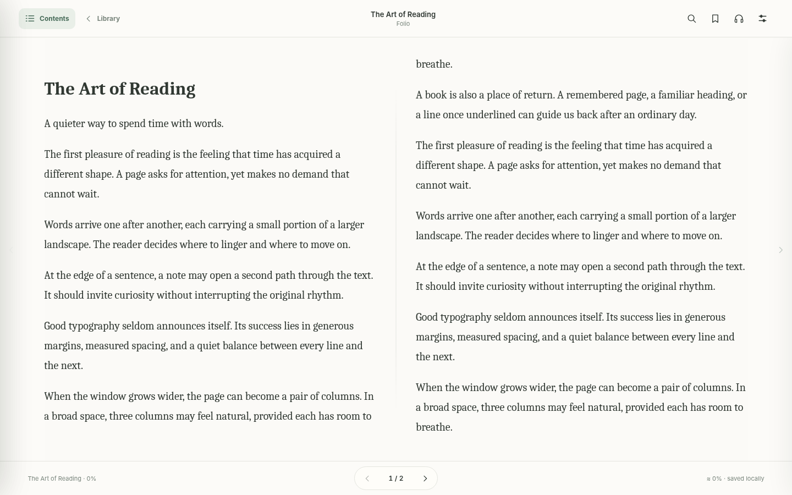

# Folio

**A quiet, local-first EPUB reader for the browser.**

Folio is a lightweight, paginated reading application for Microsoft Edge and Chrome. It combines multi-column typography, natural text-to-speech, bilingual word lookup, footnote navigation, and a private book library. You can use it as a standalone HTML file or install it as a Progressive Web App (PWA).



## Features

- **Page-based reading:** automatic one-, two-, or three-column spreads based on available width, with keyboard, mouse wheel, and margin-click navigation. No vertical page scrolling.
- **Typography:** independent Chinese and English font selection, including Libertinus Serif, EB Garamond, Microsoft YaHei, Sitka, and source Han / Noto CJK families. Includes bundled English web fonts and optional Chinese online font fallbacks.
- **Text to speech:** uses the voices made available by Edge or Chrome, with separate language choices, speed controls, progress following, and remembered voice preferences.
- **EPUB search:** a dedicated worker searches chapter text progressively, with chapter-wide or entire-book scope, snippets, and jump-to-result. Search is initialized only when needed, bounded to the first 260 matches and approximately 8 MB of cached extracted text. No extra WASM dependency or permanent full-text index.
- **Footnotes:** preview existing EPUB footnotes on hover, navigate on click, and return to the previous reading position. Annotation marks use script-sensitive spacing for Chinese and English.
- **Dictionary:** English definitions with pronunciation options and Chinese meanings from browser-accessible online providers when available. Word-form fallback handles common plural and verb endings.
- **Library and privacy:** import DRM-free EPUBs locally, resume reading, manage bookmarks, remove individual books and associated data, or clear all saved data.
- **Installable PWA:** a service worker caches the app shell for offline reopening; imported books remain in browser storage.

## Quick start

### Standalone HTML

Download `Folio-EPUB-Reader-v21-Standalone.html` and open it in Edge or Chrome. Import a DRM-free EPUB from the library view. The reader itself can function offline; dictionary lookups and some web fonts require an internet connection. Direct `file://` browsing cannot be installed as a PWA, and its storage is separate from an HTTPS-hosted copy.

### Install as a PWA

1. Put `index.html`, `manifest.webmanifest`, `sw.js`, `icons/`, and `docs/` on a static website over **HTTPS**, or serve the folder from **localhost**.
2. Open the site's `index.html` in Microsoft Edge or Google Chrome.
3. Use the browser's **Install app** option (or the in-page Install control when available).

For local development, any static HTTP server works. For example, from the project directory, run `python -m http.server 8765` and open `http://127.0.0.1:8765/`. A server is **not required** for the standalone HTML version.

**Important:** Browser storage belongs to its origin. Books stored under `file://`, `http://127.0.0.1:8765`, and your HTTPS domain do not automatically transfer between them.

## Using Folio

| Action | Control |
| --- | --- |
| Return to library | **Library** in the header |
| Browse the table of contents | **Contents** (left edge of the reading interface) |
| Search the current EPUB | Magnifying glass or **Ctrl+F** / **Cmd+F** |
| Change typography or appearance | **Appearance** |
| Turn pages | On-screen arrows, Left/Right, Page Up/Page Down, scroll wheel, or outer reading margins |
| Preview an existing EPUB footnote | Hover over its reference |
| Navigate to an EPUB footnote | Click its reference, then use **Back to text** |
| Look up an English word | Click it in the reading text |
| Start read-aloud | **Read aloud**; it starts at the visible page |

## How search works

Folio intentionally avoids a large always-on search index. When you first search in a book, an isolated **Web Worker** opens the EPUB ZIP and extracts readable text one chapter at a time. It returns batches of results as they are found, keeping page rendering interactive. A small least-recently-used cache holds up to approximately four million UTF-16 text units (about 8 MB). The UI debounces input, cancels obsolete search runs and limits the result set to avoid overwhelming the interface for common search terms.

Search is **literal, case-insensitive and Unicode-normalized**; it is not semantic or fuzzy search. Certain EPUB constructs (for example, text inside SVG images or complex ruby annotations) may not be searchable. EPUB navigation jumps to the closest matching occurrence after chapter layout.

## Storage and privacy

EPUB files are imported into the browser's **IndexedDB**. Preferences, reading progress and bookmarks use browser local storage. Local reading does not require an account or uploading an EPUB to a server. Online dictionary requests submit the looked-up word to the corresponding external provider; online voice services may transmit spoken text according to your browser's voice provider. The PWA cache contains the application shell, not your EPUB files.

To remove one book, use its delete control in Library. To erase all data, use the storage controls in Appearance. Browser eviction or manual site-data clearing can remove locally saved books: retain a backup of your EPUB files.

## Supported formats and limitations

- Designed for **DRM-free, reflowable EPUB 2 / EPUB 3** documents.
- Fixed-layout EPUBs, DRM-protected files and unusually complex publisher scripts are not supported.
- Footnote previews require actual note references in the EPUB. Folio does not fabricate missing source links.
- Recorded dictionary audio and some Chinese web fonts depend on network access and provider availability. Browser Natural voice availability varies by Edge/Chrome version and operating system.
- Search does not read words baked into images or scanned pages.

## Project files

```text
folio/
├── index.html                 # Self-contained reader, including bundled JS and English fonts
├── LICENSE                    # MIT license for Folio source code
├── manifest.webmanifest       # PWA metadata
├── sw.js                      # Offline app-shell cache
├── icons/
│   ├── folio-192.png
│   └── folio-512.png
├── docs/
│   └── reader-preview.png
└── README.md
```

The separately distributed `Folio-EPUB-Reader-v21-Standalone.html` contains the reader but no installable PWA resources.

## Development and contributing

Folio currently uses browser-native HTML/CSS/JavaScript, **JSZip** for EPUB ZIP parsing, Web Workers for background search, IndexedDB, Speech Synthesis and CSS multicolumn layout. No build step is needed for the distributed `index.html`.

Contributions and bug reports are welcome. A useful issue includes the browser/version, viewport width, relevant reader settings, steps to reproduce, and a small **shareable** EPUB that demonstrates the problem (avoid uploading copyrighted books without permission).

## Credits and licensing

Folio includes JSZip and selected bundled English fonts. Their upstream licenses and copyright notices are retained in the HTML distribution, including the embedded font notices. EPUB books remain the property of their respective authors and publishers.

**Folio's original source code is licensed under the [MIT License](LICENSE).** See `LICENSE` for the full terms. Third-party libraries, embedded fonts and their associated assets retain their own licenses and copyright notices; the MIT license for Folio does not relicense those dependencies.
