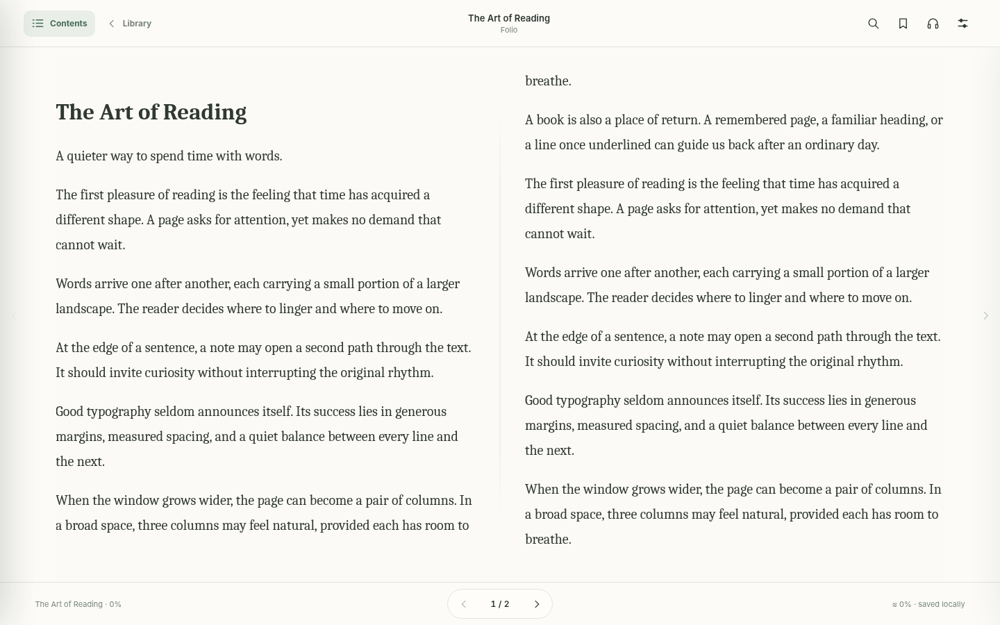

# Folio

A clean, installable EPUB reader for Edge and Chrome. Folio runs entirely in the browser: no account, backend, or desktop executable.



## Features

- Distraction-free, paginated reading with adaptive 1–3 column layouts and fast keyboard, wheel, and touch navigation.
- English and Chinese fonts, Paper/Warm/Night/System themes, and publisher-font override.
- Read aloud with device voices or an **experimental direct Edge neural WebSocket** provider. Bilingual speech and word/line highlighting are supported; connection acceptance varies by browser.
- Word lookup, bookmarks, chapter search, reading history, and a searchable table of contents.
- Local EPUB library with shelves, favorites, reading progress, and ZIP backup/restore.
- Installable PWA with an offline app shell. EPUB files are stored locally in IndexedDB.

## Use Folio

1. Deploy the contents of the PWA release ZIP to any HTTPS static site (such as GitHub Pages), or open the optional standalone HTML file directly in Edge/Chrome.
2. Open Folio, import an EPUB, and select a book.
3. To install the PWA, use the browser's **Install app** option when available.

> Keep the same site origin when updating: browser storage is origin-specific. Export a full-library ZIP before moving or upgrading.

## Fonts and privacy

Chinese typography offers two unified choices: **Source Han / Noto Serif** and **Source Han / Noto Sans**. Folio first checks installed Source Han or Noto CJK Regular fonts, then requests the official **Noto SC** Regular/Bold webfonts from `fonts.googleapis.com` and `fonts.gstatic.com` only when needed. On Android, Folio also prefers the built-in Noto CJK Chinese fallback when the named local font is not exposed. Other installed fonts remain available from the font menu. No manual font upload is required and no font files are bundled.

Books, reading positions, and shelves remain in your browser's storage. **Direct neural TTS sends the current spoken passage to Microsoft when selected.** It is opt-in, unofficial, and can be rejected by browser WebSocket restrictions. Device TTS remains the default and works independently. The PWA caches application files for offline use, not imported EPUBs or dictionary requests. Export a ZIP backup before changing browsers or hosting origins.

## Development

The PWA is a static HTML/CSS/JavaScript app with no build step. Regression tests are in `tests/` (Python + Playwright, and a Node.js service-worker test).

```bash
python -m pip install playwright
python -m playwright install chromium
python tests/smoke.py
python tests/direct_neural_v94.py
node tests/service_worker_v88.cjs
```

See [CHANGELOG.md](CHANGELOG.md) for version history and [QUICK_START_PWA.md](QUICK_START_PWA.md) for deployment details.

## License

[MIT](LICENSE)

### Edge Android voices

Edge on Android may report no voices before its speech engine starts. In Folio, open **Appearance & data → Read aloud** and tap a voice selector; Folio activates the voice engine in that tap and then refreshes the menu. A brief, quiet preview may be audible. Some Edge-provided voices may still be inaccessible to the standard Web Speech API.

### Experimental neural streaming

Under **Appearance & data → Read aloud → Voice provider**, select **Edge neural · direct streaming** to choose its Chinese/English voices. Use **Test direct connection** to check your browser. The implementation communicates with Microsoft directly over a WebSocket, buffers each short passage into MP3, plays it with Web Audio, and uses returned word timestamps for tracking. It does not require native Edge TTS or a Folio server.

The API is undocumented and is not guaranteed to work in normal browser tabs, including Edge Android/iOS, Chrome, or Safari: WebSocket handshakes can be rejected because a PWA cannot supply the privileged headers of native clients. Folio reports the failure and does not silently switch providers. Select **Device voices** to resume local playback.
